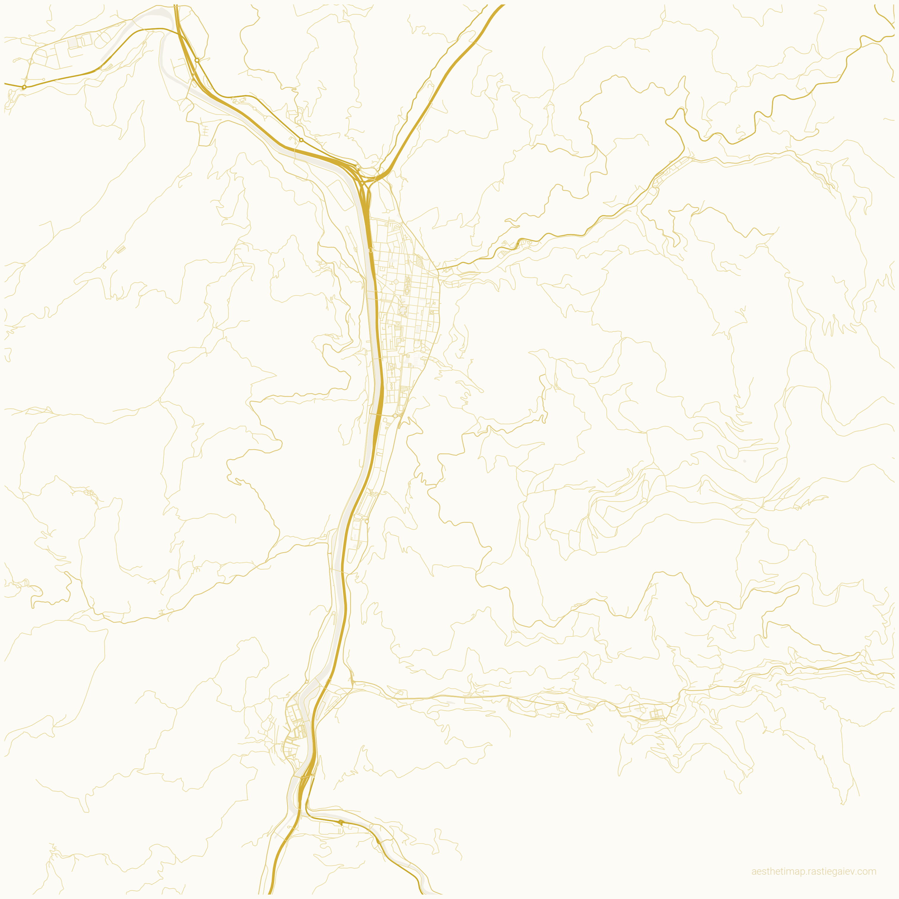

# AesthetiMap

Create customizable city map posters using OpenStreetMap data, curated themes, and PNG, SVG, or PDF exports. Adjust coverage up to 50,000 meters, print dimensions from 2 to 40 inches, title placement, gradients, building shadows, and topography.



## Run locally

Use Docker Compose for the frontend at http://localhost:8080 and the backend at http://localhost:8000:

```bash
mkdir -p cache posters
# On Linux, allow the backend container's UID/GID 1001 to write these bind mounts.
sudo chown -R 1001:1001 cache posters
docker compose -f docker-compose.dev.yml up -d --build
```

The production compose file expects an existing external Docker network named `contolstation` and an outer reverse proxy connected to it. Configure that proxy to forward to `frontend:80` and set `X-Real-IP` from its own remote address. It must overwrite any incoming client-supplied `X-Real-IP` header.

```bash
docker network create contolstation
docker compose up -d --build
```

Both configurations keep cached map data in `./cache` and generated posters in `./posters`. Posters expire through automatic cleanup; regenerate expired shared posters.

## CLI

Install Python dependencies and run the renderer:

```bash
pip install -r backend/requirements.txt -r requirements.txt
python renderer.py --city "Kyiv" --country "Ukraine" --theme gold_on_porcelain --span 20000
python renderer.py --help
```

## Configuration

Set these environment variables on the backend service in the compose file:

| Variable | Default | Purpose |
| --- | --- | --- |
| `MAX_CLEANUP_DAYS` | `7` | Maximum poster age in days. |
| `MAX_CLEANUP_MB` | `1024` | Maximum total poster storage in MB. |
| `CLEANUP_INTERVAL_HOURS` | `6` | Time between cleanup runs. |
| `MAX_SPAN_M` | `50000` | Maximum map coverage in meters. |
| `MAX_QUEUED` | `5` | Maximum queued generation jobs. |
| `JOB_TIMEOUT_SECONDS` | `600` | Generation job timeout in seconds. |
| `STUCK_GRACE_SECONDS` | `300` | Extra time after a timeout before a stuck process exits and Docker restarts it. |
| `TILES_URL` | `https://tiles.openfreemap.org/planet` | OpenMapTiles-schema TileJSON endpoint. |
| `PUBLIC_TILES_URL` | Value of `TILES_URL` | Browser-accessible TileJSON endpoint for the live preview. |
| `HTTP_USER_AGENT` | `map-poster-service/1.0` | Identifying User-Agent sent to map services. |

## Checks

Browser regression tests: in `frontend`, run `npm run build && npm run test:e2e` (first time: `npx playwright install chromium`).

```bash
pip install -r backend/requirements.txt -r requirements.txt -r requirements-dev.txt
flake8 --max-line-length=160
pytest -q
cd frontend
npm ci
npm test
npm run build
```

## Credits and license

AesthetiMap is based on [maptoposter by Ankur Gupta](https://github.com/originalankur/maptoposter), with application development by Denys Rastiegaiev. The software is distributed under the [MIT License](LICENSE).

Map data © [OpenMapTiles](https://www.openmaptiles.org/) © [OpenStreetMap contributors](https://www.openstreetmap.org/copyright), available under the [Open Database License (ODbL)](https://opendatacommons.org/licenses/odbl/). Keep the appropriate map attribution when sharing generated posters.

## Vector tile data

Map geometry comes from OpenMapTiles-schema vector tiles, supplied by [OpenFreeMap](https://openfreemap.org) by default. TileJSON is cached for one hour, with a stale fallback during provider outages. Tiles and geocoder JSON results are cached on disk.

Provider terms are hard limits: at most four concurrent requests, 1,000 tile requests and 45 MB per user job. The renderer targets at most 200 tiles and lowers zoom if a tile set exceeds 30 MB. Individual tiles are limited to 8 MB. These limits apply to server rendering during user jobs; the renderer does not prefetch or refresh data in the background. The browser preview also loads vector tiles as the map is framed.

For self-hosting, set `TILES_URL` to any TileJSON server using the OpenMapTiles schema, for example `go-pmtiles serve`. HTTPS tile templates are required unless the TileJSON endpoint itself uses HTTP. Preserve the generated attribution: “© OpenMapTiles © OpenStreetMap contributors · aesthetimap.rastiegaiev.com”.

## Live preview

The editor starts with Kyiv and a 12 × 16 inch Terracotta poster. Drag or zoom the sheet to frame the map, or choose a city from the place list. Coverage measures the longest side of the poster. Changing the print dimensions keeps the map center and coverage. Theme colors, lettering, buildings, and fades update before generation; contours appear in the finished poster.

Create a poster to download PNG, SVG, or PDF, or copy a link to the setup and generated file. Editing returns to the live map. If the browser cannot display the preview, poster generation remains available.

Add up to five marks using Heart, Pin, Dot, Target, Star, Home, or Flag. Each mark has a label, size, opacity, and a theme color or custom color. Center marks follow the poster center; placed marks keep their coordinates when the city changes. Drag a mark on the live map or use the arrow keys to move it, press Delete to remove it, and use Center to return it to the poster center. Marks outside the sheet are listed as “Outside the map”. Two or more marks can be joined with a dotted line. Shared setup links preserve marks and the line.

The API accepts a `markers` array and `connect` boolean. Each marker contains `type`, `lat`, `lon`, `size` (12–500 points on a 12 inch sheet), `opacity` (0.15–1), `color` (`text`, `road_motorway`, `water`, or `#rrggbb`), and an optional label of up to 40 characters. Both coordinates must be null for a center mark or supplied together for a placed mark. The legacy `show_heart` API field, URL parameter, and CLI flag remain supported.

The scale ruler uses 1/2/5 lengths near a quarter of the sheet width. In the small gaps where no such length fits the requested 15–35% interval (for example, 1,400 m of horizontal coverage), it uses the nearest nice length.

For a custom public tile provider, allow its origin in the frontend nginx `connect-src` policy as well as setting `PUBLIC_TILES_URL`. The public URL must be reachable by the browser and allow cross-origin requests.

The gallery wall, frame and controls follow the selected theme. The mat and frame scale with the sheet while preserving the map coverage and print aspect ratio. Theme thumbnails are local WebP assets: run `tools/theme_thumbnails.py` whenever a theme is added.
